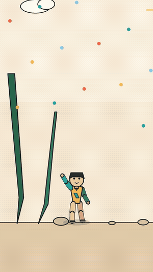

# VIDEO_MULT — генератор вертикальных мультиков кодом

Пайплайн для коротких роликов **1080×1920 (Reels / Shorts / TikTok)**: сценарий → озвучка →
покадровый рендер мультфильма → музыка и SFX → сборка mp4. Никаких видео-моделей, GPU и облачных
сервисов: картинка рисуется кодом (Pillow), звук синтезируется (numpy/scipy), голос — Edge TTS.

Два готовых примера (flat 2D, 26–27 с):

| Файл | Серия |
|---|---|
| [`demo/ant_scale_02.mp4`](demo/ant_scale_02.mp4) | «Что, если ты станешь размером с муравья?» — 7 сцен, сила/вода/тепло/падение |
| [`demo/gravity_loss_03.mp4`](demo/gravity_loss_03.mp4) | «Что будет, если человек потеряет гравитацию?» — снос на восток, утечка воздуха, кровь в голову, раскол планеты |

Исходники обеих серий — в `episodes/<slug>/`: текст, сцены, камера и партитура звука.



---

## Что внутри

| Модуль | Зачем |
|---|---|
| `engine/flat2d.py` | Палитра, примитивы (капсулы, полигоны, плашки, стикеры), 2D-риг человечка с FK-углами, муравей, титры |
| `episodes/<slug>/ep_ant.py` | Сцены серии: позы, камера, реквизит, UI-слой, таймлайн, рендер кадров |
| `episodes/<slug>/audio.py` | Музыка (BPM из настроек), SFX, сведение с голосом по RMS |
| `episodes/<slug>/lines.txt` | Текст реплик — единственный источник таймингов |
| `tools/make_voice.py` | Озвучка: Edge TTS через прокси или Piper (офлайн), ретраи, `voice/lines.json` |
| `tools/build.py` | Энкод, loudnorm, GIF-петля, контактный лист, ffprobe |
| `settings.json` | Все ручки: разрешение, fps, палитра, темп речи, громкости, шрифты, пути |

## Установка

```bash
git clone https://github.com/AliShovk/VIDEO_MULT.git
cd VIDEO_MULT
python -m pip install -r requirements.txt
```

Нужны **ffmpeg/ffprobe** в PATH (Windows: `winget install Gyan.FFmpeg` или распакованный билд),
шрифт с кириллицей (по умолчанию `segoeuib.ttf` / `segoeui.ttf` в Windows).

Edge TTS в РФ часто недоступен напрямую — укажите в `settings.json` свой прокси:

```json
"voice": { "proxy": "http://127.0.0.1:10809" }
```

Если прокси нет — переключите движок на офлайн: `"engine": "piper"` и укажите пути к
`piper.exe` и модели `ru_RU-*-medium.onnx`.

## Быстрый старт (пример серии)

```bash
# 1. озвучка (создаст voice/line_XX.wav + voice/lines.json)
python tools/make_voice.py episodes/ant_scale_02/lines.txt

# 2. музыка + SFX + сведение
python episodes/ant_scale_02/audio.py

# 3. предпросмотр кадров (без рендера целиком)
python episodes/ant_scale_02/ep_ant.py --preview

# 4. рендер кадров (~2–3 мин на 800 кадров при 3 воркерах)
python episodes/ant_scale_02/ep_ant.py --render

# 5. сборка mp4 + GIF + контактный лист
python tools/build.py
```

Результат: `out.mp4`, `preview_loop.gif`, `contact_sheet.jpg`.

## Как сделать свою серию

1. Скопируйте `episodes/ant_scale_02` → `episodes/<новый_slug>`.
2. В `lines.txt` напишите 6–8 коротких реплик (по 8–14 слов), первая — хук с цифрой или парадоксом.
3. `python tools/make_voice.py episodes/<slug>/lines.txt` — тайминги появятся сами.
4. В `ep_ant.py` поправьте сцены: `scene0…sceneN`, список `SCENE_FN`, `CAMS`, `CAPS`. Каждая сцена —
   функция от времени, никакого состояния: кадр можно отрендерить отдельно.
5. `--preview`, смотрите `preview/full_*.png`, правьте, затем `--render` и `tools/build.py`.

Подробнее — [`docs/HOWTO.md`](docs/HOWTO.md). Все настройки — [`docs/SETTINGS.md`](docs/SETTINGS.md).

## Ключевые приёмы (чтобы не наступать на грабли)

- **Хук в первые 1–2 секунды.** Первая реплика и первый кадр несут цифру или парадокс; никаких
  логотипов и «сегодня мы узнаем».
- **Движение в каждой сцене.** Slow push камеры + действие персонажа; смена плана каждые 3–5 с.
  Статичная картинка = слайд-шоу, даже если позы разные.
- **Реквизит цепляется к суставам.** `hero()` возвращает `hands/head/feet`; крошка ставится по
  ладоням, а кисти перерисовываются поверх предмета — иначе предмет «парит» над головой.
- **Титры выше нижних 250 px.** UI Reels/Shorts перекрывает низ кадра.
- **Громкость: голос главнее.** Гейны считаются от RMS-цели (`voice 0.15`, `music 0.026`),
  финал — `loudnorm I=-14 LUFS`.
- **Смена голоса = смена таймингов.** Все сцены строятся от `voice/lines.json`; после правки
  озвучки кадры нужно перерендерить.

## Структура репозитория

```
VIDEO_MULT/
├── engine/flat2d.py            # движок рисования и рига
├── episodes/ant_scale_02/      # серия «размером с муравья»
├── episodes/gravity_loss_03/   # серия про отключённую гравитацию
├── tools/make_voice.py         # озвучка (Edge через прокси / Piper)
├── tools/build.py              # энкод + loudnorm + превью
├── settings.json               # все настройки
├── settings.py                 # загрузчик настроек
├── docs/HOWTO.md               # пошагово: новая серия
├── docs/SETTINGS.md            # таблица настроек
├── demo/                       # готовый ролик
└── preview/                    # gif и контактный лист
```

## Ограничения

- Риг примитивный: голова-круг, капсульные конечности, кисти без пальцев, лицо точками/линиями.
  Эмоции — позой, камерой и графикой, а не мимикой; липсинка нет.
- Один персонаж на серию (риг заточен под него). Новый герой — новый набор форм в `flat2d.py`.
- Рендер на 4 ядрах: ~0.45 с/кадр, 800 кадров ≈ 6 минут в один процесс, ~2–3 минуты на 3 воркерах.

## Лицензия

MIT — см. [`LICENSE`](LICENSE).
